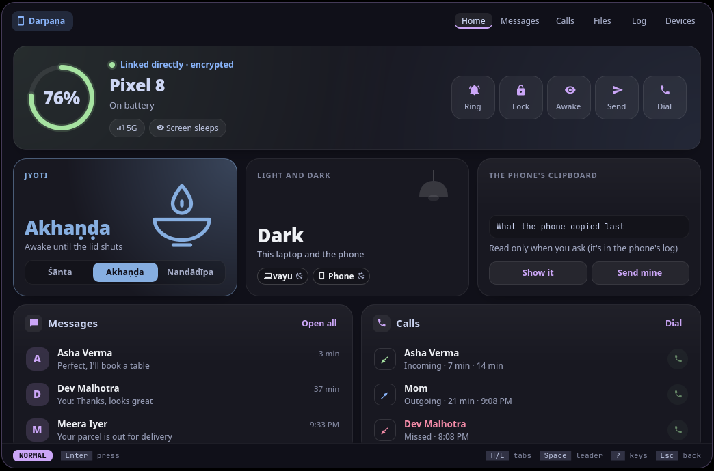
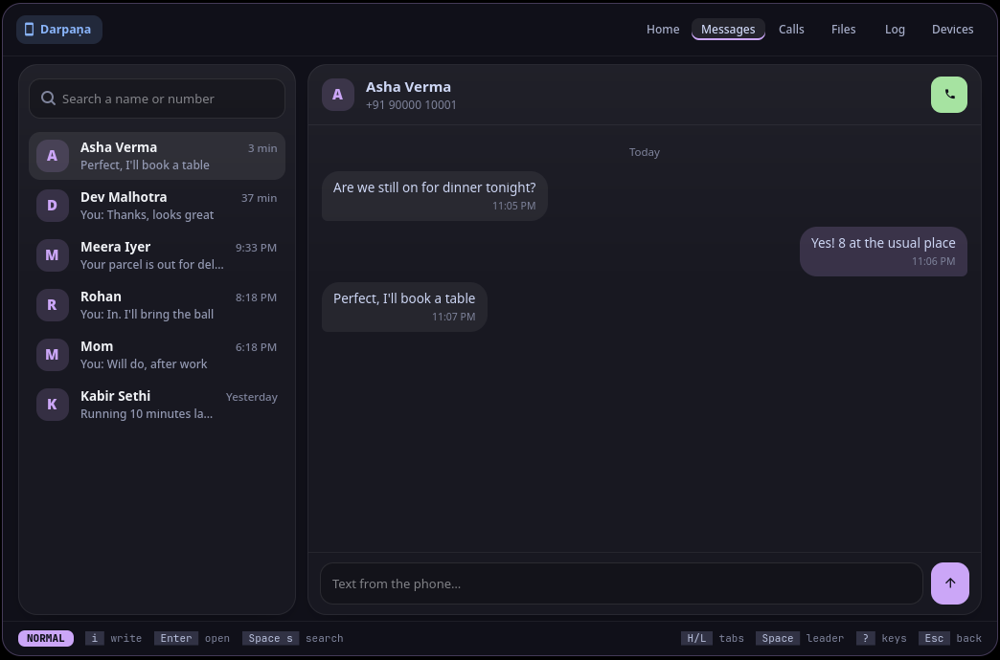
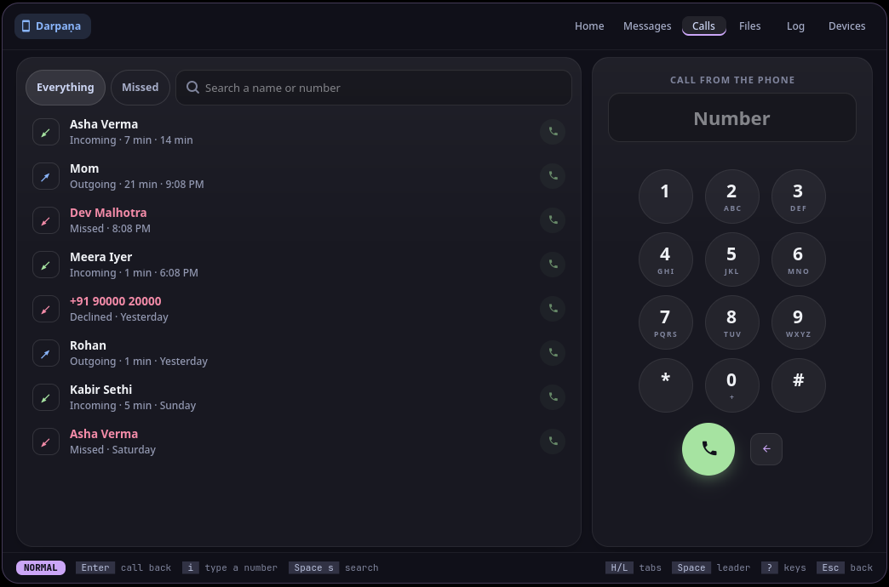
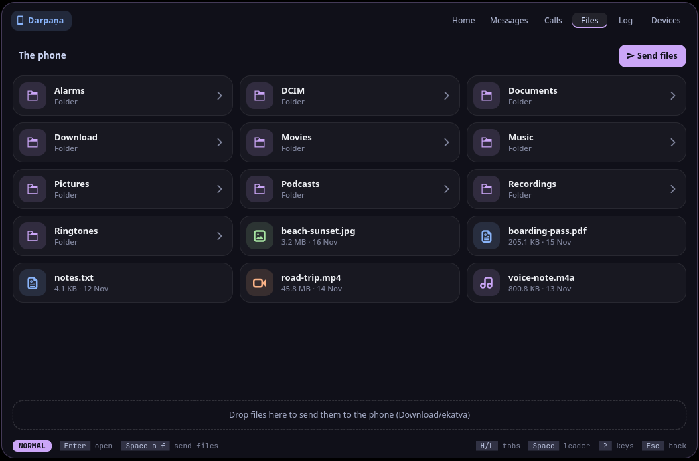

# Darpaṇa

<!-- identity -->
<p align="center">
  <br>
  <b>यथादर्शे तथात्मनि यथा स्वप्ने तथा पितृलोके ।<br>
  यथाप्सु परीव ददृशे तथा गन्धर्वलोके छायातपयोरिव ब्रह्मलोके ॥</b><br>
  <i>As in a mirror, so in the self; as in a dream, so in the world of the fathers; as in water, so in the world of the Gandharvas; as light and shade, in the world of Brahmā.</i><br>
  <sub>Kaṭha Upaniṣad 2.3.5</sub>
</p>
<!-- /identity -->

<p align="center">
  
</p>
<p align="center">
  
  
</p>
<p align="center">
  
</p>
<p align="center"><sub>Screenshots use made-up demo data (<code>scripts/demo-service.py</code>).</sub></p>

> *Darpaṇa* (दर्पण) is Sanskrit for "the mirror": your phone, mirrored on the laptop.

It's the laptop's side of [ekatva](https://github.com/Theyashsawarkar/ekatva) (एकत्व, "oneness": the phone and the laptop as one device), as a [Vyom](https://github.com/Theyashsawarkar/vyom) popup. It opens at once: Vyom is already running, and the popup shows what it knew last while fresh state loads.

- **Overview**: the phone (battery, how it's linked; ring, lock, keep awake, send a file, dial), jyoti, keeping the laptop awake (Śānta, at rest; Akhaṇḍa, the diya; Nandādīpa, the samai, even with the lid closed), light and dark for both (the lamp), the phone's clipboard, the last messages and calls.
- **Messages**: the phone's conversations, one open beside them, text from the phone.
- **Calls**: the call history and a dialer; an incoming call shows at the top of every place, with Answer and Decline, and a call in progress with its timer and Hang up.
- **Files**: the phone's folders; drop files on the popup (or pick them) to send them to its Download/ekatva.
- **Log**: this laptop's action log (or the copy of the phone's), whether the chain checks out, and Undo.
- **Devices**: the paired phones, what each may do here (switches grouped by risk), unpairing, and pairing a new phone (a QR code, then four emoji).

It talks to ekatva's own service over its local socket (`$XDG_RUNTIME_DIR/ekatva.sock`, or `$EKATVA_SOCKET`), with nothing beyond Python's standard library. Reading the phone's messages, calls and clipboard is written to the phone's log, so they're read when you go to them, not every time the popup opens.

## Install

```sh
kosha install darpana            # or clone into ~/.local/share/vyom/plugins/darpana
systemctl --user restart vyom
vyom darpana            # or: vyom darpana calls | messages | files | log | devices | pair
```

`ekatva window` opens it too (and the pairing notification does).

## Keys

<!-- KEYS (generated by scripts/keybinds.py from darpana/vim.py) -->

Vyom's vim keys work too: `?` and `Space ?` list every key, `Space Space` is the palette, `q` closes, `Esc` steps back, `Space u f` is fullscreen, `Space r` refreshes; on a card `j` / `k` move between controls, `h` / `l` change the focused one and `Enter` presses it.

**Leader (Space)**

| Key | Action |
|---|---|
| `Space j s` | Set jyoti Śānta (the laptop sleeps and locks as usual) |
| `Space j a` | Set jyoti Akhaṇḍa (keep the laptop awake: no lock, no sleep until the lid shuts) |
| `Space j n` | Set jyoti Nandādīpa (keep the laptop awake, even with the lid closed) |
| `Space p r` | Toggle phone ring (find it: full volume until pressed again) |
| `Space p l` | Lock the phone |
| `Space p k` | Toggle the phone's screen staying on |
| `Space p a` | Answer the phone's incoming call |
| `Space p h` | Hang up the phone's call (or decline it) |
| `Space p d` | Dial a number from the phone (the Calls place) |
| `Space l l` | Toggle the laptop's light / dark mode |
| `Space l p` | Toggle the phone's light / dark mode |
| `Space l b` | Switch both to light or dark (the lamp) |
| `Space g o` | Go to home (the phone at a glance) |
| `Space g m` | Go to the phone's messages |
| `Space g c` | Go to the phone's calls |
| `Space g f` | Go to the phone's files |
| `Space g l` | Go to the action log |
| `Space g d` | Go to the paired devices and their permissions |
| `Space y c` | Copy the phone's clipboard to this laptop's |
| `Space y p` | Copy this laptop's clipboard to the phone |
| `Space a p` | Add a phone (shows the pairing code; works from any network) |
| `Space a f` | Add a file to the phone (send it to Download/ekatva) |
| `Space s` | Search messages or calls by name or number |
| `Space r` | Reload what this place shows |

<!-- END KEYS -->
